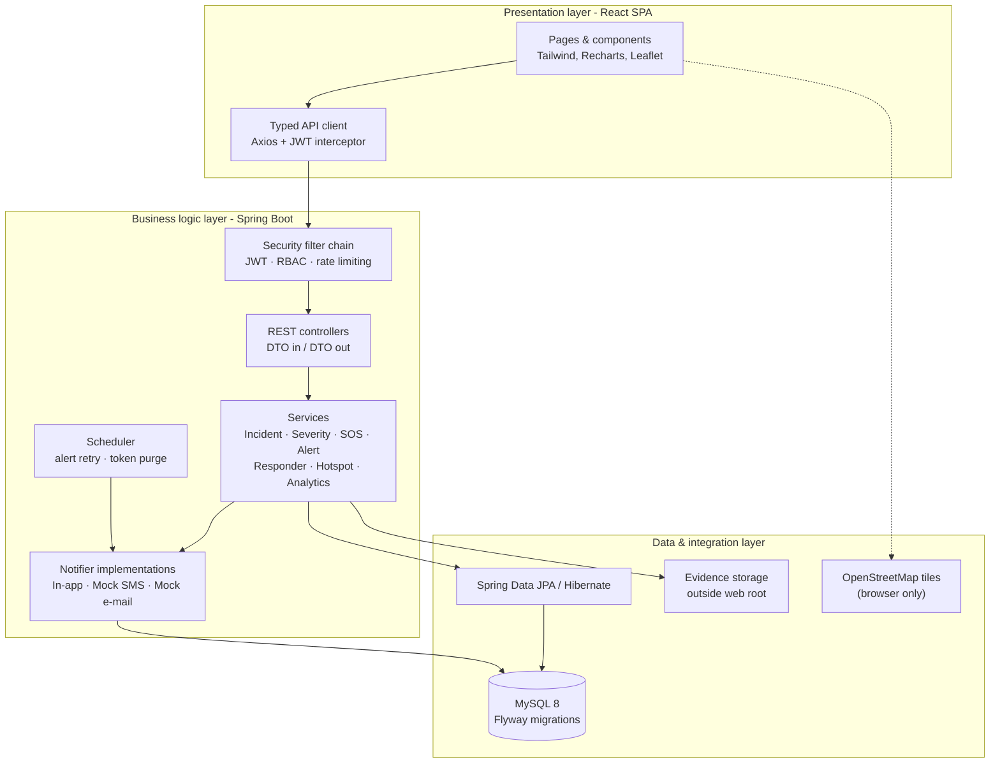
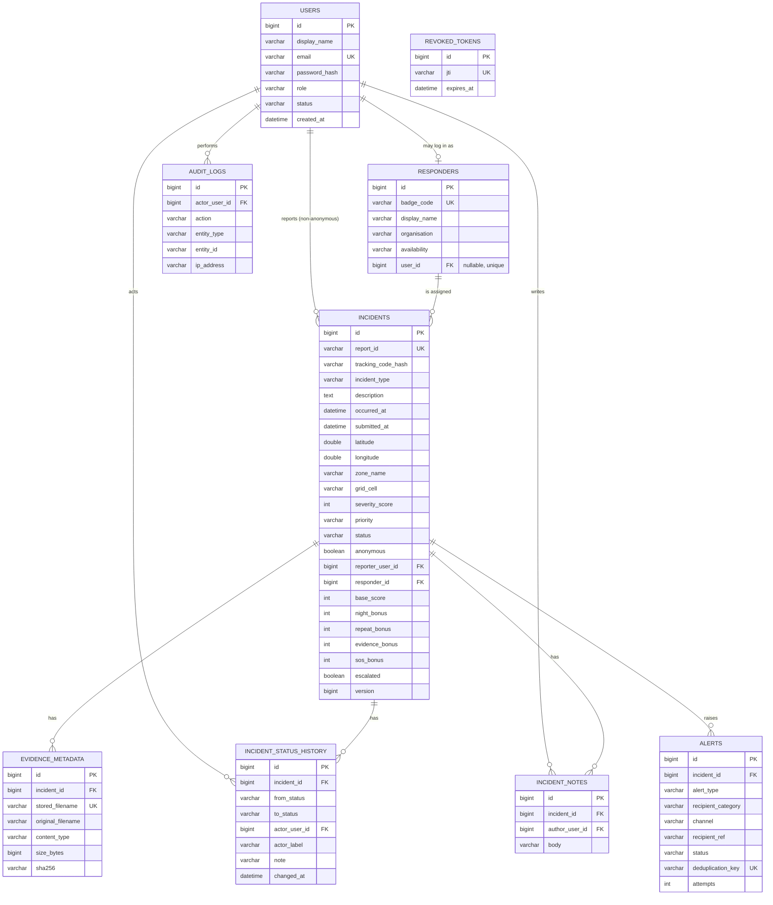

# Women Safety Incident Reporting Platform

A secure, anonymous and data-driven full-stack web application to report safety incidents, prioritise them automatically, simulate an SOS alert, track a case privately and identify unsafe zones from real report data.

> **Project-Based Learning (PBL) submission** · OOTs in Java (CCSE0355) · Noida Institute of Engineering and Technology, Greater Noida.
> This is a college prototype. It is **not** an emergency service and is **not** connected to the police or any helpline.

---

## Table of contents

1. [Overview](#1-overview)
2. [Problem statement](#2-problem-statement)
3. [Objectives](#3-objectives)
4. [Key features](#4-key-features)
5. [Technology stack](#5-technology-stack)
6. [Architecture](#6-architecture)
7. [Project structure](#7-project-structure)
8. [Database design & ER diagram](#8-database-design--er-diagram)
9. [Severity scoring algorithm](#9-severity-scoring-algorithm)
10. [Hotspot detection algorithm](#10-hotspot-detection-algorithm)
11. [Java OOP concepts in the codebase](#11-java-oop-concepts-in-the-codebase)
12. [Security & privacy design](#12-security--privacy-design)
13. [API overview](#13-api-overview)
14. [Demo accounts & seed data](#14-demo-accounts--seed-data)
15. [Prerequisites](#15-prerequisites)
16. [Local setup (Windows)](<#16-local-setup-windows>)
17. [Running the application](#17-running-the-application)
18. [Testing & verification](#18-testing--verification)
19. [Common errors & solutions](#19-common-errors--solutions)
20. [Limitations](#20-limitations)
21. [Future enhancements](#21-future-enhancements)
22. [Documentation and demo materials](#22-documentation-and-demo-materials)
23. [Team](#23-team)

---

## 1. Overview

Safety incidents are often under-reported because the process is slow, intimidating and rarely anonymous. Reports that do arrive are scattered across phone calls, paper forms and social media, so urgent cases compete with minor ones and location patterns stay invisible.

The **Women Safety Incident Reporting Platform** addresses this with one integrated application:

- a **public reporting flow** that works without an account;
- a **Java backend** that validates every request, computes a severity score, stores the report in MySQL and raises alerts;
- a **case-management dashboard** where administrators review, assign, escalate and resolve cases;
- a **hotspot map** built from the reports themselves;
- **private, credential-based tracking** for anonymous reporters.

Everything is real: real REST endpoints, real JWT authentication, real MySQL persistence, real tests. The only deliberately simulated parts are **SOS notification delivery** (no SMS/e-mail provider) and the **fictional demo dataset**.

---

## 2. Problem statement

| Problem | Consequence |
|---|---|
| Reporting is intimidating and rarely anonymous | Incidents go unreported; repeat offenders stay invisible |
| Reports arrive through scattered channels | No structured record, no way to search or audit |
| No automatic prioritisation | Urgent cases wait behind minor complaints |
| No location-wise analysis | Unsafe zones and repeat incidents remain hidden |

The project targets **SDG 5 (Gender Equality)** and **SDG 11 (Sustainable Cities and Communities)** by making reporting safer and turning reports into preventive insight.

---

## 3. Objectives

1. Provide a simple, secure incident-reporting process.
2. Support anonymous reporting without a name, phone number or account.
3. Calculate severity automatically with the algorithm defined in the project presentation.
4. Prioritise incidents as **LOW / MEDIUM / HIGH / CRITICAL**.
5. Generate a unique, unpredictable **Report ID** for every submission.
6. Provide a simulated **SOS** workflow that records emergency alerts and optional location.
7. Notify authorised administrators and responders through persistent alert records.
8. Identify potential **hotspots** with a documented grid-based algorithm.
9. Let reporters track a case without exposing confidential information.
10. Give administrators tools to assign responders, update statuses and resolve cases.
11. Store all data persistently in **MySQL**.
12. Demonstrate Java OOP, collections, algorithms and layered architecture in a real project.

---

## 4. Key features

### Citizen-facing
- Modern landing page explaining anonymity, prioritisation and privacy.
- Incident reporting with category, description, date/time, zone, optional GPS, optional evidence and an anonymity toggle.
- Confirmation page with Report ID, one-time tracking code, priority and a clear prototype warning.
- Private tracking with a Report ID + tracking code (description and evidence are never exposed).
- Simulated SOS with confirmation, optional geolocation, cooldown and honest delivery status.
- Citizen dashboard, “My reports” and profile/settings.

### Administrator-facing
- Live dashboard: totals, today, pending, in progress, resolved, critical, active SOS, hotspots, failed alerts.
- Case queue with search, category/priority/status/date filters, sorting and pagination.
- Incident detail: description, severity breakdown, location, evidence, responder, status history, internal notes and alert history.
- Status lifecycle with validated transitions and a mandatory resolution note.
- Manual escalation to CRITICAL, regardless of the computed score.
- Responder directory with availability and workload.
- Alert feed with channel, delivery status and a retry action for failed alerts.
- Hotspot map (Leaflet + OpenStreetMap) with grid intensity, legend and method note.
- Analytics with charts, response-time statistics and a privacy-restricted CSV export.

### Responder-facing
- A queue containing only cases assigned to the signed-in responder.
- Status updates for assigned cases only.
- Assignment and escalation remain administrator-only.

---

## 5. Technology stack

| Layer | Technology | Version |
|---|---|---|
| Language | Java | 17 target (runs on 17–25) |
| Backend framework | Spring Boot (Web, Data JPA, Security, Validation, Actuator) | 3.5.16 |
| Build | Maven | 3.9.x |
| Database | MySQL | 8.x |
| Migrations | Flyway (`flyway-core` + `flyway-mysql`) | managed by Boot |
| Authentication | JWT (JJWT) + BCrypt | JJWT 0.12.6 |
| Tests | JUnit 5, Mockito, MockMvc, AssertJ, H2 | managed by Boot |
| Frontend | React + TypeScript | React 19, TypeScript 7 |
| Frontend build | Vite | 8.x |
| Styling | Tailwind CSS | 3.4 |
| Routing | React Router | 7.x |
| Forms & validation | React Hook Form + Zod | RHF 7, Zod 3.25 |
| HTTP client | Axios | 1.x |
| Charts | Recharts | 3.x |
| Maps | Leaflet + React-Leaflet + OpenStreetMap tiles | Leaflet 1.9 |

> The presentation mentions Java 17 with Swing/JavaFX and raw JDBC. The implementation intentionally uses **Spring Boot + Spring Data JPA**, which the course brief requires for this full-stack iteration; JPA sits on top of JDBC. The trade-off is documented in [docs/architecture.md](docs/architecture.md).

---

## 6. Architecture

Three layers plus cross-cutting security:



**Request flow for a report**

1. The browser posts `multipart/form-data` containing a JSON `payload` part and an optional `evidence` file.
2. Spring Security allows the endpoint anonymously; the rate-limit filter applies.
3. Bean Validation checks the DTO; business rules (location pairing, contact requirement, evidence) run in `IncidentService`.
4. `SeverityScoringService` selects the category strategy and computes the score.
5. A Report ID and tracking code are generated; only a BCrypt hash of the tracking code is stored.
6. The incident, evidence metadata and initial status history are saved in **one transaction**.
7. Alerts are created (in-app + simulated e-mail) and delivered asynchronously.
8. The response returns the Report ID, tracking code, score and priority — never a stack trace.

See [docs/architecture.md](docs/architecture.md) for the layer responsibilities, package map and transaction boundaries.

---

## 7. Project structure

```
women-safety-platform/
├── backend/
│   ├── pom.xml
│   ├── .env.example
│   └── src/
│       ├── main/
│       │   ├── java/com/womensafety/
│       │   │   ├── WomenSafetyApplication.java
│       │   │   ├── config/          # Security, CORS, async, demo seeder
│       │   │   ├── controller/      # Auth, Incident, Tracking, SOS, Admin, Responder…
│       │   │   ├── dto/             # Records grouped by module
│       │   │   ├── entity/          # User, Incident, Responder, Alert, history…
│       │   │   ├── enums/           # Roles, statuses, priorities, channels
│       │   │   ├── exception/       # Custom exceptions + global handler
│       │   │   ├── notification/    # Notifier interface + implementations
│       │   │   ├── repository/      # Spring Data JPA repositories
│       │   │   ├── scheduler/       # Alert retry / token purge
│       │   │   ├── scoring/         # Severity strategies (polymorphism)
│       │   │   ├── security/        # JWT, principal, rate limiting, access policy
│       │   │   ├── service/         # Business logic
│       │   │   └── util/            # Report IDs, grid projection
│       │   └── resources/
│       │       ├── application.yml
│       │       ├── application-dev.yml
│       │       └── db/migration/V1__init_schema.sql
│       └── test/
│           ├── java/com/womensafety/…   # Unit + integration tests
│           └── resources/application-test.yml
├── frontend/
│   ├── package.json
│   ├── vite.config.mjs
│   ├── tailwind.config.js
│   ├── .env.example
│   └── src/
│       ├── api/          # Axios client + typed endpoint modules
│       ├── components/   # common, layout
│       ├── context/      # AuthContext
│       ├── pages/        # 21 pages
│       ├── types/        # API contract types
│       └── utils/        # constants, formatting, class names
├── database/create_database.sql
├── docs/                 # architecture, database, API, demo, testing, Postman
├── scripts/              # PowerShell start/test helpers
├── docker-compose.yml    # optional MySQL service
└── README.md
```

---

## 8. Database design & ER diagram

MySQL 8, utf8mb4, InnoDB. Schema is created by **Flyway** (`V1__init_schema.sql`); Hibernate runs with `ddl-auto: validate`, so an entity/schema mismatch fails fast instead of silently changing the database.



**Key design decisions**

- **Anonymous reports** are stored with `anonymous = 1` and `reporter_user_id = NULL`. There is no hidden identity column. A registered user who ticks “anonymous” is *not* linked either.
- **Tracking credentials** are never stored in plaintext: `tracking_code_hash` is BCrypt. Losing the code is unrecoverable, which is the safe default.
- **Status history is append-only**, so the full audit trail survives every transition.
- **Severity components are persisted**, letting the detail page show an auditable breakdown rather than a single opaque number.
- **Evidence files live outside the web root**; only metadata is in MySQL, and downloads go through an authorised endpoint.
- **Alerts are rows**, not log lines: the alert feed is a real query with delivery status, attempts and error details.
- **Indexes** cover status, priority, submission time, grid cell, reporter and responder; unique constraints protect e-mail, report ID, badge code and alert deduplication.

The complete table list and relationships are documented in [docs/database.md](docs/database.md).

---

## 9. Severity scoring algorithm

The authoritative score is always computed in the **Java backend** (`com.womensafety.scoring`). The frontend never calculates it.

### Base scores

| Incident type | Base score |
|---|---:|
| Verbal harassment (`VERBAL_HARASSMENT`) | 20 |
| Cyber harassment (`CYBER_HARASSMENT`) | 30 |
| Stalking (`STALKING`) | 35 |
| Assault (`ASSAULT`) | 60 |
| Sexual assault (`SEXUAL_ASSAULT`) | 80 |
| Other (`OTHER`) | 20 — documented prototype default (the presentation defines none) |

### Additive factors

| Factor | Rule | Points |
|---|---|---:|
| Night-time | Occurred between **22:00 (inclusive)** and **05:00 (exclusive)** in `Asia/Kolkata` | +15 |
| Repeat reports | Each eligible earlier report in the same ~500 m grid cell within **30 days**, capped | +10 each, max +20 |
| Evidence | A validated file was attached | +5 |
| Live SOS | Incident created through the SOS workflow | +20 |

```
score = min(100, baseScore + nightBonus + repeatBonus + evidenceBonus + sosBonus)
```

### Priority bands

| Score | Priority |
|---|---|
| 0–29 | `LOW` |
| 30–49 | `MEDIUM` |
| 50–69 | `HIGH` |
| 70–100 | `CRITICAL` |

### Documented choices

- **Repeat window**: incidents *submitted* in the last 30 days, same `grid_cell`, excluding the incident being scored and excluding `CLOSED` cases. When coordinates are absent, the normalised `zone_name` is used instead.
- **Cap**: the repeat bonus is capped at +20 and the total at 100.
- **Night boundary**: 22:00 is night, 05:00 is day; both are tested.
- **Manual override**: an administrator can escalate any case to `CRITICAL`. The stored score is unchanged; the override and its reason are audited and shown in the UI.
- **Safety**: the score is a triage aid, not a validated danger assessment. It never dismisses a report and never blocks human review.

Implementation: `SeverityScoringService` + one strategy per category (`AbstractSeverityStrategy` template method). Tests: `SeverityScoringServiceTest` covers every category, both night boundaries, repeat caps, evidence, SOS, the 100 cap and the 29/30/49/50/69/70 thresholds.

---

## 10. Hotspot detection algorithm

Implemented in `HotspotDetectionService`, using real incident rows.

1. Load incidents from the last **30 days** (configurable) that have valid coordinates.
2. Convert each coordinate into a deterministic grid cell.
3. Count reports per cell in a `HashMap`.
4. Compute the **mean** and **population standard deviation** of the populated cell counts.
5. Flag a cell when `count > mean + 1 × standard deviation` (strictly greater).
6. Rank flagged cells with a **bounded min-heap `PriorityQueue`** (O(n log k), top-K configurable).
7. Return cell centre, report count, intensity, zone label and the contributing report IDs.

### Grid strategy (~500 m)

Rounding decimal places creates cells whose physical size changes with latitude, so the implementation uses a **local equirectangular projection**:

```
x = R · cos(refLat) · lonRad
y = R · latRad
cell = ( floor(x / 500), floor(y / 500) )
```

`refLat` defaults to **28.5355°N** (Noida). At that latitude cells are 500 m × 500 m; within ±0.5° the width error is under 1%. Cell centres are converted back to latitude/longitude for display. This is an approximation, not a geodesic grid, and is documented in the UI and API.

### Statistical choices and edge cases

- **Zero-report cells are excluded** from the population (documented and applied consistently).
- No incidents → empty result with `insufficientData = true`.
- One populated cell → standard deviation 0, `count > count` is false, so no hotspot.
- Identical counts → no hotspot.
- Invalid or missing coordinates → ignored, not counted.
- Fewer than 3 cells or fewer than 5 reports → flagged as `insufficientData` (the algorithm still runs).
- The map is **administrator-only**; public pages never expose precise coordinates.
- The UI states that hotspots reflect submitted reports, not verified crime rates or danger predictions.

Tests: `HotspotDetectionServiceTest` (dense cluster, empty input, single cell, identical counts, invalid coordinates, map payload).

---

## 11. Java OOP concepts in the codebase

| Concept | Where it is demonstrated |
|---|---|
| **Encapsulation** | `User`, `Incident`, `Alert` have private fields and controlled mutators (`applySeverity`, `assignTo`, `updateStatus`, `escalate`); no public setters on the incident lifecycle |
| **Abstraction** | `AbstractSeverityStrategy` (template method), `Notifier` interface, `EvidenceStorageService` interface, `ApiException` base class |
| **Inheritance** | Six concrete `SeverityStrategy` subclasses share one scoring template; `InAppNotifier`, `MockSmsNotifier`, `MockEmailNotifier` implement `Notifier` |
| **Polymorphism** | `SeverityScoringService` dispatches to the strategy for the incident type; `AlertService` dispatches to the notifier for the channel |
| **Interfaces** | `SeverityStrategy`, `Notifier`, `EvidenceStorageService`, Spring Data repositories |
| **Exception handling** | `InvalidReportException`, `IncidentNotFoundException`, `UnauthorizedIncidentAccessException`, `InvalidStatusTransitionException`, `TrackingVerificationException`, unified by `GlobalExceptionHandler` (RFC 9457 problem details) |
| **Collections** | `HashMap` for grid counting and strategy registry; `PriorityQueue` for hotspot ranking; `ArrayList` for ordered results; `EnumSet`/`Map` for the status transition graph |
| **Multithreading** | `@Async("alertExecutor")` for alert delivery with a bounded thread pool; `ThreadPoolTaskExecutor` config; retry scheduler |
| **Generics** | `PageResponse<T>`, Spring Data `Page<T>`/`Specification<T>` |
| **JPA / JDBC** | Spring Data JPA over Hibernate over JDBC; JPQL projections and specifications; no raw JDBC layer |

**Trade-off:** the presentation's `Incident` inheritance hierarchy (Harassment, Assault, …) is not mapped as JPA inheritance, because a single `incidents` table with a category enum is far more maintainable for filtering, reporting and migrations. Polymorphism is preserved where it carries real behaviour: the **scoring strategy hierarchy**. This choice is explained in [docs/architecture.md](docs/architecture.md).

---

## 12. Security & privacy design

### Authentication & authorisation
- BCrypt password hashing (cost 12).
- Stateless JWT access tokens (HS256, 2-hour TTL) with `jti`; logout writes a revocation row so a token cannot be replayed.
- `SecurityFilterChain` enforces `ADMIN` on `/api/admin/**` and `ADMIN|RESPONDER` on `/api/responder/**`; every other endpoint requires authentication except the explicit public list.
- Resource-level checks in `IncidentAccessPolicy`: citizens read only their own reports; responders read only assigned cases; anonymous access requires the tracking code.
- IDOR protection is centralised instead of being duplicated in controllers.

### Input & upload security
- Bean Validation on every request DTO, plus business validation in services.
- Coordinates must be provided as a pair and within range; the incident time cannot be in the future.
- Evidence is validated by **magic bytes** (JPEG, PNG, WEBP, PDF), capped at 5 MB, renamed server-side and stored outside the web root.
- Evidence is served only via `/api/evidence/{incidentId}/{evidenceId}` with an access check and `X-Content-Type-Options: nosniff`.
- No entity is returned from a controller; request/response DTOs prevent over-posting and lazy-loading leaks.

### Abuse prevention
- In-memory fixed-window rate limits per client: login 8/min, tracking 15/min, reports 8/min, SOS 6/min (configurable).
- Report IDs carry ~40 bits of entropy; tracking codes ~60 bits and are grouped for manual entry.
- Tracking failures return the **same 404** whether the ID or the code is wrong.
- Alert deduplication uses a unique key, so retries and concurrent submissions cannot create duplicates.

### Privacy
- Anonymous reports store no identity and are never linked to an account.
- Tracking responses expose status, priority, general zone and status history only.
- Admin CSV exports exclude descriptions, contacts and coordinates; formula characters are escaped.
- Logs never contain passwords, tokens, full descriptions or exact coordinates.
- The privacy page explains application-level anonymity versus network anonymity without overclaiming.

---

## 13. API overview

Base URL: `http://localhost:8080/api`. Authentication: `Authorization: Bearer <token>`.

| Method | Endpoint | Access | Purpose |
|---|---|---|---|
| POST | `/auth/register` | public | Create a citizen account, returns JWT |
| POST | `/auth/login` | public | Password login |
| GET | `/auth/me` | authenticated | Current profile |
| PATCH | `/auth/profile` | authenticated | Update display name / phone |
| POST | `/auth/change-password` | authenticated | Change password |
| POST | `/auth/logout` | authenticated | Revoke the current token |
| POST | `/incidents` | public | Submit a report (JSON or multipart with evidence) |
| GET | `/incidents/my` | authenticated | Reports linked to the account |
| GET | `/incidents/{id}` | authenticated | Owner-only incident detail |
| POST | `/incidents/{reportId}/evidence` | owner / tracking code | Add evidence to an existing report |
| POST | `/reports/track` | public + credentials | Status-only tracking |
| POST | `/sos` | public | Create a simulated SOS alert |
| GET | `/sos/{reportId}` | public + `X-Tracking-Code` | SOS status |
| GET | `/admin/dashboard/summary` | ADMIN | Live counters |
| GET | `/admin/incidents` | ADMIN | Filter/sort/paginate the queue |
| GET | `/admin/incidents/{id}` | ADMIN | Full case detail |
| PATCH | `/admin/incidents/{id}/status` | ADMIN | Validated lifecycle transition |
| PATCH | `/admin/incidents/{id}/assign` | ADMIN | Assign/reassign a responder |
| POST | `/admin/incidents/{id}/escalate` | ADMIN | Manual CRITICAL override |
| POST | `/admin/incidents/{id}/notes` | ADMIN | Internal note |
| GET | `/admin/incidents/{id}/evidence/{evidenceId}` | ADMIN | Authorised evidence download |
| GET/POST/PATCH | `/admin/responders` | ADMIN | Directory management |
| GET | `/admin/responders/{id}/incidents` | ADMIN | Workload drill-down |
| GET | `/admin/alerts` | ADMIN | Alert feed with filters |
| POST | `/admin/alerts/{id}/retry` | ADMIN | Retry a failed delivery |
| GET | `/admin/hotspots` / `/admin/hotspots/map` | ADMIN | Hotspot analysis / map cells |
| GET | `/admin/analytics/overview` / `/incidents` / `/response-times` | ADMIN | Chart data |
| GET | `/admin/analytics/export.csv` | ADMIN | Privacy-restricted CSV |
| GET | `/evidence/{incidentId}/{evidenceId}` | ADMIN / assigned responder | Authorised evidence download |
| GET | `/responder/profile` / `/responder/incidents` | RESPONDER | Own profile and assigned queue |
| PATCH | `/responder/incidents/{id}/status` | RESPONDER (assigned) | Status update |

Full request/response examples, status codes and error shapes: [docs/api.md](docs/api.md). A ready-to-import Postman collection is in [docs/postman_collection.json](docs/postman_collection.json).

**Error format**

```json
{
  "type": "https://womensafety.local/errors/validation-failed",
  "title": "Invalid request",
  "status": 400,
  "detail": "Some fields need attention.",
  "code": "validation-failed",
  "errors": { "description": "Description must be 20-4000 characters" },
  "instance": "/api/incidents",
  "timestamp": "2026-10-25T11:41:03.940Z"
}
```

---

## 14. Demo accounts & seed data

Created **only** by the dev seeder (`app.demo.seed-enabled=true`, active in the `dev` profile). The seeder is idempotent: if any user or incident exists, it does nothing.

| Role | Email | Password |
|---|---|---|
| Administrator | `admin@demo.local` | `Demo@12345` |
| Responder | `responder@demo.local` | `Demo@12345` |
| Responder (second unit) | `responder2@demo.local` | `Demo@12345` |
| Citizen | `citizen@demo.local` | `Demo@12345` |

- 27 fictional incidents across Noida / Greater Noida landmarks, spread over ~3 weeks, with two reported today.
- Four fictional responder units (campus desk, NGO team, metro assistance, night patrol).
- All statuses represented, including active SOS and resolved cases.
- Seeded reports use the tracking code `DEMO-TRACK-2026` so the tracking page can be demonstrated.
- Alert rows for every incident, with in-app status `SENT` and SMS/e-mail status `SIMULATED`.

**All seeded records are fictional.** Sample responders are explicitly described as demo units, not police officers.

> Never enable `SEED_ENABLED=true` in a deployed environment. Passwords come from `DEMO_PASSWORD` and must be changed for anything beyond a college demo.

---

## 15. Prerequisites

| Tool | Version | Check |
|---|---|---|
| JDK | 17 or newer (21 recommended) | `java -version` |
| Maven | 3.9+ | `mvn -version` |
| Node.js | 20+ (22+ recommended) | `node -v` |
| npm | 10+ | `npm -v` |
| MySQL | 8.x | `mysql --version` |
| Git | any | `git --version` |

Optional: Docker Desktop (for the provided MySQL compose file), VS Code with the Java and Tailwind extensions.

You do **not** need Docker, and you do **not** need a global Gradle installation.

---

## 16. Local setup (Windows)

### 16.1 Install and verify Java

```powershell
java -version
javac -version
```

Install Temurin JDK 17 or 21 if missing, then set `JAVA_HOME`:

```powershell
[Environment]::SetEnvironmentVariable("JAVA_HOME", "C:\Program Files\Eclipse Adoptium\jdk-21...", "User")
```

### 16.2 Install Node.js

Install the LTS build from nodejs.org and confirm `node -v` / `npm -v`.

### 16.3 Install and start MySQL 8

Install MySQL Community Server (or use `docker compose up -d`). Verify:

```powershell
Get-Service *mysql*
mysql -u root -p -e "SELECT VERSION();"
```

### 16.4 Create the database and application user

```powershell
cd women-safety-platform
mysql -u root -p < database\create_database.sql
```

The script creates the `women_safety` schema and the `ws_user` account. Change the password in the script and in `backend\.env`.

### 16.5 Configure environment variables

```powershell
cd backend
Copy-Item .env.example .env
```

Fill in `DB_PASSWORD` and a long random `JWT_SECRET`. Spring Boot reads ordinary environment variables; the `.env` file is a template you copy values from (or load with your IDE/terminal).

Minimal PowerShell session:

```powershell
$env:DB_URL      = "jdbc:mysql://localhost:3306/women_safety?useSSL=false&allowPublicKeyRetrieval=true&serverTimezone=UTC&characterEncoding=UTF-8"
$env:DB_USERNAME = "ws_user"
$env:DB_PASSWORD = "your-password"
$env:JWT_SECRET  = "at-least-32-random-characters-here"
$env:EVIDENCE_DIR = ".\data\evidence"
```

### 16.6 Database migrations

Flyway runs automatically on backend startup and applies `V1__init_schema.sql`. Hibernate then **validates** the schema. To inspect the result:

```sql
USE women_safety;
SHOW TABLES;
SELECT version, description, success FROM flyway_schema_history;
```

---

## 17. Running the application

### 17.1 Backend

```powershell
cd backend
mvn spring-boot:run "-Dspring-boot.run.profiles=dev"
```

Backend: <http://localhost:8080> · health: <http://localhost:8080/actuator/health>

Or build a jar:

```powershell
mvn -DskipTests package
java -jar target\women-safety-backend-1.0.0.jar --spring.profiles.active=dev
```

### 17.2 Frontend

```powershell
cd frontend
npm install
npm run dev
```

Frontend: <http://localhost:5173>. Vite proxies `/api` to port 8080, so no CORS configuration is needed in development.

### 17.3 Open the app on a phone

`vite.config.mjs` sets `server.host: true`, so the dev server already listens on the local network (and `allowedHosts: true` permits tunnel hostnames). The phone only talks to port 5173; Vite forwards `/api` to Spring Boot on the same computer.

**Same Wi-Fi (recommended, private)**

```powershell
.\scripts\show-mobile-link.ps1
```

It prints something like `http://192.168.31.182:5173`. Open that address on the phone (the phone and the laptop must be on the same Wi-Fi). If it does not load, allow Node.js through Windows Firewall for **Private** networks, or run once in an administrator PowerShell:

```powershell
New-NetFirewallRule -DisplayName "Vite dev 5173" -Direction Inbound -Protocol TCP -LocalPort 5173 -Action Allow -Profile Private
```

**Any network, including mobile data (temporary public link)**

```powershell
winget install --id Cloudflare.cloudflared   # one time
.\scripts\start-tunnel.ps1
```

The script prints a public `https://<random>.trycloudflare.com` URL. Notes:

- The link works from anywhere while the tunnel window stays open; it changes on every restart.
- It is **public**: anyone with the link reaches the demo, including the seeded admin login. Use it only during the demo and stop the tunnel (Ctrl+C) afterwards.
- No account is required for a quick tunnel; Cloudflare does not guarantee uptime for account-less tunnels.

Both servers must keep running: MySQL, the Spring Boot backend on 8080 and `npm run dev` on 5173. Closing the laptop or the terminal breaks the link.

### 17.4 Helper scripts

```powershell
.\scripts\start-backend.ps1 -DbPassword "your-password" -JwtSecret "your-32+-char-secret"
.\scripts\start-frontend.ps1 -Install
.\scripts\run-backend-tests.ps1
.\scripts\show-mobile-link.ps1
.\scripts\start-tunnel.ps1
```

### 17.5 Production build and stable demo mode

```powershell
cd frontend
npm run build      # outputs frontend/dist
npm run serve      # serves dist on http://localhost:4173 and proxies /api to 8080
```

`npm run serve` (`frontend/server/serve-dist.mjs`) serves the **built** app instead of the Vite dev server. Use it for phone access or a long-running demo: it sends one hashed JS file and one CSS file instead of hundreds of dev modules, caches assets, supports SPA deep links and proxies `/api` without CORS.

Point the tunnel at port 4173 (`cloudflared tunnel --url http://localhost:4173`) rather than 5173 when the app has to stay up for a long time. The public URL is still a temporary Cloudflare quick tunnel: the hostname stays the same while the tunnel process lives, and changes if that process restarts.

Serve `dist` with any static host and set `VITE_API_BASE_URL` to the deployed API origin at build time (e.g. `VITE_API_BASE_URL=https://api.example.com npm run build`).

### 17.6 First login

Open <http://localhost:5173/login> and use `admin@demo.local` / `Demo@12345`. The admin dashboard should show the seeded counts. Citizens use `citizen@demo.local`, responders use `responder@demo.local`.

### 17.7 Reset the development database

```powershell
mysql -u root -p -e "DROP DATABASE women_safety;"
mysql -u root -p < database\create_database.sql
```

Restart the backend with the `dev` profile to reseed. Never do this against data you need.

### 17.8 Run everything from VS Code

Open the **`women-safety-platform`** folder in VS Code (not its parent).

**Recommended extensions** (VS Code offers them automatically from `.vscode/extensions.json`):

- Extension Pack for Java
- Spring Boot Extension Pack
- Tailwind CSS IntelliSense

**One-click run:** `Terminal → Run Task… → Women Safety: Start Dev Stack`

That opens three terminals and starts:

| Task | What it does | URL |
|---|---|---|
| Start MySQL | portable MySQL on port 3307 (skips if already running) | — |
| Start Backend | `mvn spring-boot:run` with the `dev` profile | <http://localhost:8080> |
| Start Frontend | Vite dev server | <http://localhost:5173> |

Open <http://localhost:5173> and sign in with `admin@demo.local` / `Demo@12345`.

**Individual tasks** are available too: `Start MySQL`, `Start Backend`, `Start Frontend`, `Run Backend Tests`, `Build Frontend`.

**Debugging:** with the Java extension installed, press **F5** and choose **Women Safety: Full Stack**. It launches the backend under the debugger and opens Chrome on the frontend.

**Configuration:** `backend/.env` is read automatically (`spring.config.import`), so no environment variables need to be exported. It currently points at the portable MySQL on port 3307. If you install MySQL on the normal port 3306, change `DB_URL` there (the file is git-ignored).

If `backend/.env` is missing (for example after a fresh clone), create it:

```powershell
cd backend
Copy-Item .env.example .env
# then edit DB_URL / DB_USERNAME / DB_PASSWORD / JWT_SECRET
```

**Important:** the VS Code dev backend uses port 8080, the same port as the public-link demo. Run one at a time — if `Start Backend` says port 8080 is in use, the public demo is still running. Close the demo (or use its link) before starting the dev stack.

---

## 18. Testing & verification

### 18.1 Backend tests

```powershell
cd backend
mvn test
```

**31 backend tests, all passing.** Coverage highlights:

| Test class | What it verifies |
|---|---|
| `SeverityScoringServiceTest` (7) | Every category, night boundaries, repeat cap, evidence, SOS, 100 cap, 29/30/49/50/69/70 thresholds, a combined case |
| `HotspotDetectionServiceTest` (6) | Dense cluster detection, empty input, single cell, identical counts, invalid coordinates, map payload |
| `IncidentStatusTest` (2) | Allowed and rejected lifecycle transitions |
| `LocalEvidenceStorageServiceTest` (3) | Valid PNG accepted, disguised executable rejected, 5 MB limit |
| `ReportIdGeneratorTest` (2) | ID shape/uniqueness, unambiguous tracking codes |
| `RateLimitServiceTest` (1) | Per-bucket, per-client enforcement |
| `PlatformIntegrationTest` (10) | Registration, anonymous reporting, tracking privacy, RBAC (401/403), status workflow + invalid transitions, evidence upload, validation errors, logout revocation, SOS persistence, responder isolation |

Integration tests use an isolated **H2** database in MySQL mode with Hibernate schema generation, so the developer's MySQL data is never touched.

> On JDK 21+ Mockito's inline mock maker requires self-attachment, which newer JDKs restrict. The project ships `src/test/resources/mockito-extensions/org.mockito.plugins.MockMaker` set to `mock-maker-subclass`, so the suite runs on JDK 17–25 without extra JVM flags.

### 18.2 API acceptance run

A scripted end-to-end API run (`tools/api-e2e.mjs` in the development workspace) exercises the exact requests the UI makes, including multipart submission:

- 51 checks passed: anonymous multipart report with evidence, severity/priority, tracking (correct + wrong code), admin summary/filter/search/detail, assignment, invalid and valid transitions, resolution rule, escalation, internal notes, SOS + tracking, hotspot analysis/map, analytics overview/charts/response times, CSV export privacy, alerts + simulated status, responder queue/profile, responder and citizen RBAC denials, logout revocation, registration and invalid-payload rejection.

### 18.3 Frontend verification

- `npm test` runs **21 Vitest tests** (report form validation, formatting helpers, badges, route guard) — all passing.
- `npm run build` runs `tsc --noEmit` (strict, including the test files) and a Vite production build. Both succeed.
- The dev server serves the SPA on <http://localhost:5173>.
- Manual acceptance steps are listed in [docs/demo-script.md](docs/demo-script.md); use them for the college review.

### 18.4 Acceptance scenarios from the brief

| # | Scenario | Result |
|---|---|---|
| 1 | Anonymous stalking report → record, Report ID, severity, alert, secure tracking | Verified by integration test and API run |
| 2 | SOS with location → record, coordinates, urgent alert, honest delivery status | Verified (notification status `SIMULATED`) |
| 3 | Admin dashboard → real stats, filter, detail, assign, status change persists | Verified via API run; UI wired to the same endpoints |
| 4 | Citizen calls an admin endpoint | 403 from Spring Security |
| 5 | Empty database → zero counts, no fabricated data | Dashboard renders zeros/empty states; no seed rows are invented |
| 6 | Several recent reports in one zone → hotspots | Cluster detected at mean + 1 SD |
| 7 | Invalid submission → rejected, nothing persisted | Bean/business validation, transaction rollback |

---

## 19. Common errors & solutions

| Symptom | Cause | Fix |
|---|---|---|
| `Communications link failure` / `Connection refused` | MySQL not running or wrong port | Start the MySQL service; check `DB_URL` port |
| `Access denied for user 'ws_user'` | Password mismatch or user not created | Re-run `database/create_database.sql`, update `DB_PASSWORD` |
| `Schema-validation: missing table` | Flyway did not run / wrong schema | Check `DB_URL` points at `women_safety`; ensure `spring.flyway.enabled=true` |
| `JWT_SECRET must be at least 32 characters` | Short secret | Generate a longer random value |
| `Port 8080 already in use` | Another backend running | Stop it or set `SERVER_PORT` |
| Frontend shows “Cannot reach the server” | Backend not running | Start Spring Boot on 8080; the Vite proxy targets it |
| `401` on every request after login | Token expired/revoked | Sign in again; check system clock |
| `403 responder-profile-missing` | Responder account has no profile | Create a responder profile linked to that account (admin) |
| Evidence upload rejected | Wrong type, >5 MB, or spoofed extension | Use JPEG/PNG/WEBP/PDF under 5 MB; content is checked, not the extension |
| `429 Too many requests` | Rate limit hit | Wait a minute |
| Flyway checksum error after editing a migration | A migration was modified after being applied | Never edit applied migrations; add `V2__…` instead, or reset the dev database |
| Map tiles blank | No internet / OSM blocked | Markers and analysis still work; tiles need network |
| `npm install` peer conflict | `@hookform/resolvers` optional peers | Install with `npm install --legacy-peer-deps` if npm complains |

---

## 20. Limitations

**Prototype, not a public safety service**

- Not connected to police, ambulances, NGOs or helplines. No emergency number is dialled.
- SMS and e-mail are **simulated**; only in-app alerts are real.
- The severity score and hotspot statistics are triage aids, not validated risk assessments.

**Technical**

- Rate limiting is in-memory (single instance).
- Evidence is stored on the local filesystem, not object storage.
- No refresh tokens: sessions last up to 2 hours, then require a new login.
- No e-mail verification, password reset or MFA.
- No database backups, monitoring or deployment hardening.
- Hotspot grid uses a local projection that is accurate around NCR, not globally.
- No WebSocket push; the dashboard polls every 30 seconds.
- The UI is verified by a strict type-check, production build and API contract tests; a full browser automation pass should be repeated on the review machine.

**Privacy**

- Application-level anonymity does not guarantee network anonymity: server logs, the hosting provider or the user's device may retain metadata.
- This prototype has not been assessed against GDPR, DPDP or any legal framework.

---

## 21. Future enhancements

1. Real SMS/e-mail/helpline integrations with signed delivery receipts.
2. Trusted-contact notification with explicit consent and revocation.
3. Native mobile app with offline queuing and one-tap SOS.
4. Refresh tokens, MFA for administrators, e-mail verification.
5. Object storage (S3) with virus scanning and signed URLs.
6. Redis-backed rate limiting and distributed alert deduplication.
7. PostGIS / geohash grid for globally accurate hotspot cells.
8. Route-safety scoring and night-time walking recommendations.
9. Multilingual and voice-based reporting with accessibility audit.
10. Case SLAs, responder shifts and escalation policies.
11. Differential-privacy aggregates for public statistics.
12. Formal threat model and privacy impact assessment.

---

## 22. Documentation and demo materials

| Document | Purpose |
|---|---|
| [docs/architecture.md](docs/architecture.md) | Layers, package responsibilities, transaction and async design, trade-offs |
| [docs/database.md](docs/database.md) | Table catalogue, relationships, indexes, retention notes |
| [docs/api.md](docs/api.md) | Request/response examples, status codes, error format |
| [docs/demo-script.md](docs/demo-script.md) | 5–7 minute college demonstration script |
| [docs/deployment.md](docs/deployment.md) | Deploy to a free cloud host so the link works with the laptop off |
| [docs/testing-report.md](docs/testing-report.md) | Test report template with the executed results |
| [docs/postman_collection.json](docs/postman_collection.json) | Importable API collection |

---

## 23. Team

| Name | Roll number | Contribution |
|---|---|---|
| Mimansa Saini | 2501330100222 | Team lead · problem definition |
| Md Rehan | 2501330100221 | Architecture & documentation |
| Mohit Soni | 2501330100229 | Core Java modules |
| Mo Danish | 2501330100223 | Algorithms & database |
| Mrittika Das | 2501330100230 | UI, alerts & testing |

**Faculty mentor:** Mr. Suraj Maddeshiya · **Course:** OOTs in Java (CCSE0355) · **Institute:** NIET, Greater Noida
