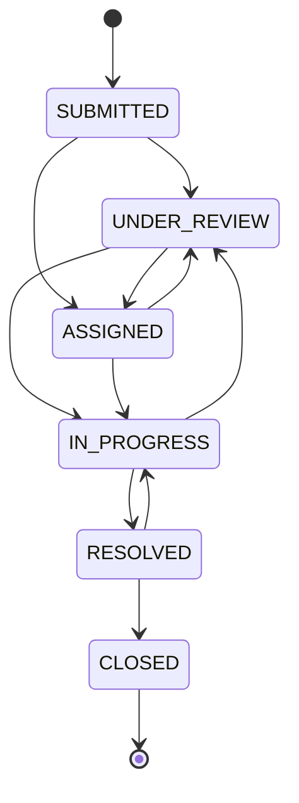

# API reference

Base URL: `http://localhost:8080/api`
Content type: `application/json` unless stated otherwise.
Authentication: `Authorization: Bearer <jwt>`.

Errors use RFC 9457 `ProblemDetail` with an extra `code` and optional `errors` map:

```json
{
  "type": "https://womensafety.local/errors/validation-failed",
  "title": "Invalid request",
  "status": 400,
  "detail": "Some fields need attention.",
  "code": "validation-failed",
  "errors": { "description": "Description must be 20-4000 characters" },
  "instance": "/api/incidents",
  "timestamp": "2026-10-25T11:41:03.940Z"
}
```

Common codes: `validation-failed`, `malformed-request`, `invalid-report`, `invalid-evidence`, `tracking-failed`, `incident-not-found`, `incident-access-denied`, `invalid-status-transition`, `responder-unavailable`, `rate-limit-exceeded`, `unauthenticated`, `forbidden`, `internal-error`.

---

## Authentication

### `POST /auth/register`
```json
{ "displayName": "Aarav Sharma", "email": "aarav@example.com", "password": "StrongPass123", "phone": "+91 90000 00000" }
```
`201 Created`
```json
{
  "token": "eyJhbGciOiJIUzI1NiJ9…",
  "tokenType": "Bearer",
  "expiresAt": "2026-10-25T13:41:03Z",
  "user": { "id": 5, "displayName": "Aarav Sharma", "email": "aarav@example.com", "role": "CITIZEN", "roleLabel": "Citizen", "createdAt": "…" }
}
```
Errors: `409` duplicate e-mail, `400` validation.

### `POST /auth/login`
```json
{ "email": "admin@demo.local", "password": "Demo@12345" }
```
`200 OK` with the same shape as registration. `401` invalid credentials.

### `GET /auth/me` → `200` user. `401` missing/expired/revoked token.

### `PATCH /auth/profile`
```json
{ "displayName": "New Name", "phone": "+91 90000 00000" }
```

### `POST /auth/change-password`
```json
{ "currentPassword": "old", "newPassword": "NewStrong123" }
```
`204 No Content`. `401` if the current password is wrong.

### `POST /auth/logout` → `204`, token id stored in `revoked_tokens`.

---

## Incidents

### `POST /incidents`
Public. Two content types:

**JSON** — same fields, no evidence.
**multipart/form-data** — `payload` part is JSON, `evidence` part is an optional file.

```json
{
  "type": "STALKING",
  "description": "A person followed me from the metro exit towards the auto stand…",
  "occurredAt": "2026-10-24T17:00:00Z",
  "zoneName": "Sector 62 Metro Station",
  "latitude": 28.6205,
  "longitude": 77.37,
  "anonymous": true,
  "contactName": null,
  "contactEmail": null,
  "contactPhone": null,
  "requiresImmediateAssistance": false
}
```

Rules:
- `description` 20–4000 characters; `occurredAt` must not be in the future.
- latitude/longitude must be supplied together and within range.
- a zone **or** coordinates are required.
- non-anonymous without an account needs at least one contact method.
- evidence: JPEG/PNG/WEBP/PDF, ≤5 MB, validated by magic bytes.

`201 Created`
```json
{
  "reportId": "WS-7K3M9Q2F",
  "trackingCode": "B4FG-P6D6-MXQM-7Q7V",
  "status": "SUBMITTED",
  "statusLabel": "Submitted",
  "priority": "HIGH",
  "priorityLabel": "High",
  "severityScore": 55,
  "submittedAt": "2026-10-25T11:13:01Z",
  "anonymous": true,
  "evidenceAttached": false,
  "alertsCreated": 2,
  "trackingHint": "Save this Report ID and tracking code. The tracking code is shown only once.",
  "disclaimer": "This prototype is not an emergency service…"
}
```
Errors: `400`, `413` (upload too large), `429`.

> The tracking code is returned **only once**. It is hashed with BCrypt before storage.

### `GET /incidents/my`
Authenticated citizen. Returns an array of summaries (newest first). Anonymous reports never appear here.

### `GET /incidents/{id}`
Authenticated owner (or admin). Returns the full detail DTO. Other users receive `403`.

### `POST /incidents/{reportId}/evidence`
`multipart/form-data` with `file`. Authenticate with a JWT **or** `X-Tracking-Code` for anonymous reports. Adding evidence recomputes the score (+5) and appends history.

---

## Tracking

### `POST /reports/track`
Public, rate limited.
```json
{ "reportId": "WS-7K3M9Q2F", "trackingCode": "B4FG-P6D6-MXQM-7Q7V" }
```
`200 OK`
```json
{
  "reportId": "WS-7K3M9Q2F",
  "type": "STALKING",
  "typeLabel": "Stalking",
  "status": "ASSIGNED",
  "statusLabel": "Assigned",
  "priority": "HIGH",
  "priorityLabel": "High",
  "submittedAt": "…",
  "occurredAt": "…",
  "zoneName": "Sector 62 Metro Station",
  "anonymous": true,
  "history": [{ "status": "SUBMITTED", "statusLabel": "Submitted", "changedAt": "…", "note": "Report submitted…" }],
  "privacyNote": "This tracking view intentionally hides…"
}
```
`404 tracking-failed` for a wrong code **and** an unknown ID — identical responses.

---

## SOS

### `POST /sos`
Public, rate limited.
```json
{ "latitude": 28.6205, "longitude": 77.37, "zoneName": "Sector 62 Metro Station", "description": "optional" }
```
`201 Created`
```json
{
  "referenceId": "SOS-7K3M9Q2FAB",
  "reportId": "WS-9PLM2XQ4",
  "trackingCode": "…",
  "activatedAt": "…",
  "status": "SUBMITTED",
  "priority": "MEDIUM",
  "severityScore": 40,
  "locationCaptured": true,
  "locationNote": "GPS coordinates were recorded with the alert.",
  "notificationStatus": "SIMULATED",
  "notificationDetail": "An in-app alert is visible to administrators now. SMS and e-mail delivery are simulated…",
  "alerts": ["Administrator in-app feed: created", "On-call safety desk SMS: SIMULATED"],
  "disclaimer": "DEMO MODE - this is a college prototype…"
}
```

### `GET /sos/{reportId}`
Public with header `X-Tracking-Code`. Returns the same tracking view.

---

## Administrator

All `/admin/**` endpoints require `ROLE_ADMIN`; otherwise `403`.

### `GET /admin/dashboard/summary`
```json
{
  "totalIncidents": 27,
  "todayIncidents": 2,
  "pendingIncidents": 13,
  "inProgressIncidents": 4,
  "resolvedIncidents": 8,
  "criticalIncidents": 3,
  "activeSosAlerts": 1,
  "hotspotsDetected": 2,
  "failedAlerts": 0,
  "unassignedActive": 9,
  "priorityBreakdown": { "LOW": 3, "MEDIUM": 12, "HIGH": 9, "CRITICAL": 3 },
  "statusBreakdown": { "SUBMITTED": 7, "UNDER_REVIEW": 6, "ASSIGNED": 4, "IN_PROGRESS": 4, "RESOLVED": 4, "CLOSED": 2 },
  "generatedAt": "…"
}
```

### `GET /admin/incidents`
Query: `q`, `type`, `priority`, `status`, `from`, `to` (ISO-8601), `sort` (`severity|created|updated`), `direction` (`asc|desc`), `page` (0-based), `size` (≤100).

Default order: severity score desc, then submission time desc.

### `GET /admin/incidents/{id}`
Full detail including description, coordinates, contact, reporter, responder, severity breakdown, evidence metadata, history, notes, alerts and `allowedNextStatuses`.

### `PATCH /admin/incidents/{id}/status`
```json
{ "status": "RESOLVED", "note": "Reporter contacted; safety desk followed up." }
```
- Only transitions allowed by the lifecycle are accepted (`409 invalid-status-transition`).
- `RESOLVED` requires a note of at least 10 characters (`400`).
- Appends history and creates a status alert.

Lifecycle:



### `PATCH /admin/incidents/{id}/assign`
```json
{ "responderId": 3 }
```
Rejects `UNAVAILABLE` responders (`409 responder-unavailable`). Sets the status to `ASSIGNED` when it was `SUBMITTED`/`UNDER_REVIEW`.

### `POST /admin/incidents/{id}/escalate`
```json
{ "reason": "Caller reported an ongoing threat." }
```
Sets priority to `CRITICAL`, keeps the computed score, records the reason and an audit row.

### `POST /admin/incidents/{id}/notes`
```json
{ "note": "CCTV requested from the station manager." }
```

### `GET /admin/incidents/{id}/evidence/{evidenceId}`
Returns the file with `Content-Disposition: attachment` and `X-Content-Type-Options: nosniff`.

### Responders
- `GET /admin/responders` → array with workload counts.
- `POST /admin/responders` → `{ displayName, organisation, contactPhone?, availability?, loginEmail?, loginPassword? }` (`409` duplicate login e-mail).
- `PATCH /admin/responders/{id}` → `{ displayName, organisation, contactPhone?, availability }`.
- `PATCH /admin/responders/{id}/availability` → same body.
- `GET /admin/responders/{id}/incidents` → paginated assigned incidents.

### Alerts
- `GET /admin/alerts?status=&channel=&page=&size=`
- `GET /admin/alerts/{id}`
- `POST /admin/alerts/{id}/retry` — only `FAILED` alerts; resets to `PENDING` and re-delivers.

### Hotspots
- `GET /admin/hotspots?days=30`
```json
{
  "windowStart": "…", "windowEnd": "…", "windowDays": 30,
  "eligibleReports": 27, "cellsWithReports": 8,
  "meanCount": 3.375, "standardDeviation": 2.4463, "threshold": 5.8213,
  "insufficientData": false,
  "methodNote": "Approximately 500 m grid via a local equirectangular projection…",
  "hotspots": [{ "cellKey": "15116:6364", "centerLatitude": 28.6205, "centerLongitude": 77.3699, "reportCount": 7, "intensity": 1.0, "zoneName": "Sector 62 Metro Station", "reportIds": ["WS-…"] }]
}
```
- `GET /admin/hotspots/map?days=30` → `{ cells, hotspots, eligibleReports, threshold, disclaimer }`.

### Analytics
- `GET /admin/analytics/overview?from=&to=`
- `GET /admin/analytics/incidents?from=&to=` → category/priority/status counts, daily series, responder workload.
- `GET /admin/analytics/response-times?from=&to=` → average/median hours and per-priority averages.
- `GET /admin/analytics/export.csv?from=&to=` → UTF-8 CSV (BOM for Excel), no descriptions/contacts/coordinates, formula characters escaped.

---

## Responder

Requires `ROLE_RESPONDER` (or `ADMIN`).

- `GET /responder/profile`
- `GET /responder/incidents?page=&size=`
- `GET /responder/incidents/{id}`
- `PATCH /responder/incidents/{id}/status`

A responder requesting a case that is not assigned to them receives `403`.

---

## Evidence (shared)

`GET /evidence/{incidentId}/{evidenceId}` — admin or the assigned responder. Used by the UI because the same link must work for both roles.

---

## Rate limits

| Endpoint | Limit |
|---|---|
| `POST /auth/login` | 8 / minute / client |
| `POST /incidents` | 8 / minute / client |
| `POST /reports/track` | 15 / minute / client |
| `POST /sos` | 6 / minute / client |

Exceeding a limit returns `429` with `Retry-After` semantics documented in the body.
