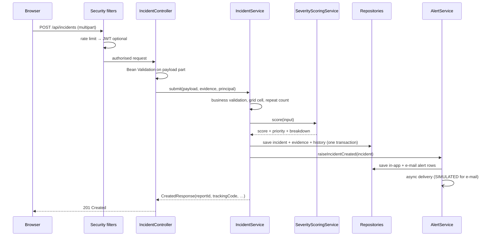

# Architecture

## 1. Style

A **layered modular monolith**. One Spring Boot process serves a JSON API consumed by a React SPA. The layers are strict:

```
Controller → Service → Repository → MySQL
     ↑           ↑
   DTOs      domain rules
```

- Controllers only translate HTTP ↔ DTOs. No business rules, no entity exposure.
- Services own transactions, validation that Bean Validation cannot express, and authorisation policy.
- Repositories are Spring Data JPA interfaces; JPQL is used only where a derived query is insufficient.
- Notification delivery is an interface (`Notifier`) with one implementation per channel.

## 2. Packages

| Package | Responsibility |
|---|---|
| `config` | Security filter chain, CORS, async executor, demo seeder |
| `controller` | Public, citizen, admin and responder endpoints |
| `dto` | Immutable records grouped by module (`AuthDtos`, `IncidentDtos`, `AdminDtos`, …) |
| `entity` | JPA entities with behaviour (`Incident.applySeverity`, `assignTo`, `escalate`) |
| `enums` | Roles, statuses, priorities, categories, channels, availability |
| `exception` | Domain exceptions + `GlobalExceptionHandler` producing RFC 9457 `ProblemDetail` |
| `notification` | `Notifier` abstraction, in-app (real) and SMS/e-mail (simulated) |
| `repository` | Data access, including specifications for the admin queue |
| `scoring` | Severity strategies, one per incident category |
| `security` | JWT parsing/issuing, principal, rate limiting, ownership policy |
| `service` | Incident, tracking, SOS, admin, responders, alerts, hotspots, analytics, storage |
| `scheduler` | Bounded alert retry, expired token-revocation cleanup |
| `util` | Report IDs, tracking codes, grid projection |

## 3. Request lifecycle (report submission)



Key property: **the file is written before the transaction commits, and deleted if the transaction fails**, so a failed submission leaves neither a database row nor an orphan file.

## 4. Transaction boundaries

| Operation | Transaction | Notes |
|---|---|---|
| Submit incident | `@Transactional` | Incident, evidence metadata and status history commit together |
| Add evidence | `@Transactional` | Metadata + recomputed score + history |
| Status change | `@Transactional` | Incident + history + alert row |
| Assign / escalate | `@Transactional` | Incident + history + alert + audit |
| Alert delivery | `REQUIRES_NEW` on the async thread | A delivery failure can be recorded without rolling back the incident |
| Seeder | one transaction per save (no outer transaction) | Allows `deliverNow` (REQUIRES_NEW) to see alert rows |

## 5. Asynchronous work

- `AsyncConfig` defines a bounded `alertExecutor` (core = max = 4, queue 500, named threads).
- `AlertService.deliverAsync` records `SENT` (in-app), `SIMULATED` (SMS/e-mail) or `FAILED` with the error.
- `AlertRetryScheduler` retries `FAILED` alerts up to 3 attempts every 2 minutes; the deduplication key prevents duplicates.
- A daily job deletes expired token-revocation rows.
- The UI never waits for delivery; it polls the dashboard every 30 seconds.

## 6. Authorisation model

| Role | Capabilities |
|---|---|
| Anonymous | Submit reports, SOS, track with credentials |
| `CITIZEN` | Everything above + own reports, profile, evidence on own reports |
| `RESPONDER` | Assigned cases only; status updates on those cases |
| `ADMIN` | Full queue, assignment, escalation, responders, alerts, hotspots, analytics, evidence |

Enforcement is layered:

1. **URL rules** in `SecurityConfig` (`/api/admin/**` → `ADMIN`).
2. **Method security** where useful (`@EnableMethodSecurity`).
3. **Resource rules** in `IncidentAccessPolicy` (owner, assigned responder, tracking code).

## 7. Algorithms

- **Severity**: strategy per category, shared template method; all bonuses additive; cap 100.
- **Hotspots**: grid counting (`HashMap`), population mean/σ, threshold `mean + σ`, ranking with a bounded `PriorityQueue`.
- **Tracking**: `SecureRandom` identifiers; BCrypt hash at rest; constant-time comparison via `matches`.
- **Repeat reports**: JPQL count with explicit self-exclusion and a 30-day window.

## 8. Frontend architecture

```
src/
  api/         axios instance (token interceptor, 401 handling) + typed modules
  context/     AuthContext (session bootstrap, login/logout)
  components/  design system + layout shells
  pages/       21 routed pages
  types/       API contract types (mirrors backend DTOs)
  utils/       constants, formatting, class names
```

- **Server state** is fetched per page; there is no global cache. Every list has loading, empty and error states.
- **Auth**: token in `sessionStorage` (per-tab), user in context; a 401 event clears both.
- **Route guards** improve UX only; the API is the security boundary.
- **Charts** (Recharts) and **maps** (Leaflet) receive only backend data.

## 9. Deliberate trade-offs

| Decision | Why | Cost |
|---|---|---|
| Single `Incident` table + enum instead of JPA inheritance | Filtering, indexing, migrations and reporting stay simple | Class hierarchy moved to the scoring strategies |
| JWT in `sessionStorage` | Survives refresh, avoids long-lived localStorage storage | XSS could read it; mitigated by React escaping and no `dangerouslySetInnerHTML` |
| In-memory rate limiting | Zero infrastructure for a prototype | Not shared across instances |
| Local filesystem evidence storage | No cloud dependency | Manual backup; interface allows S3 later |
| Polling instead of WebSockets | Reliable and simple | Up to 30 s delay in the dashboard |
| H2 for integration tests | No Docker requirement | Slight SQL dialect difference from MySQL; production schema still validated by Flyway |

## 10. Extending safely

- New incident category → add an enum constant + one strategy class + UI constant. The registry fails fast if a category has no strategy.
- New notification channel → implement `Notifier`, register as a bean. Missing channels fail at startup.
- New status → update `IncidentStatus` transitions and the UI label map; add a test for every new edge.
- New migration → add `V2__…sql`; never edit an applied migration.
